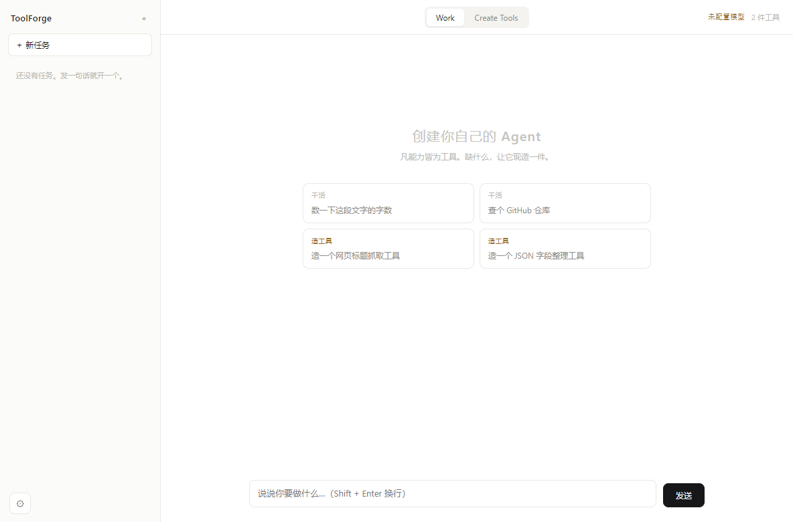
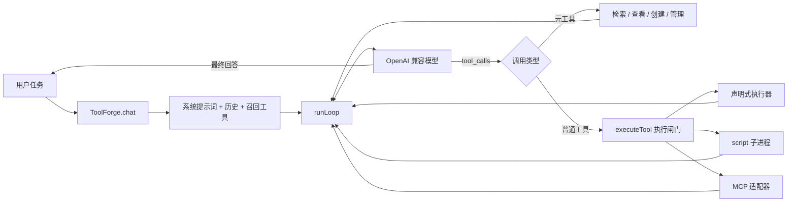

# ToolForge


> **Tool Is All You Need.**

**创建你自己的 Agent。** 模型负责决策，工具负责把决策变成可验证、可授权、可审计、可复用的行动。

ToolForge 是一个以工具为中心的桌面 Agent 运行时。它不预置一张不断膨胀的能力清单，只保留一个精简的循环：需要能力时先检索已有工具；没有合适的，就通过 `create_tool` 现场定义、测试、入库一件新工具——然后**在同一个循环里立刻用上它**。

名字致敬 [《Attention Is All You Need》](https://arxiv.org/abs/1706.03762)。我们相信 Agent 的长期壁垒不是更长的提示词，也不是更多的工作流，而是一个能持续积累、组合和治理能力的工具体系。

[](https://nodejs.org)
[](https://www.typescriptlang.org)
[](https://www.electronjs.org)
[](#项目状态)
[](./LICENSE)

[快速开始](#快速开始) · [设计理念](#为什么是-tool-is-all-you-need) · [源码教程](./doc/README.md) · [开发指南](./AGENTS.md) · [GitHub](https://github.com/tzy168/toolforge)



---

## 为什么是 Tool Is All You Need

绝大多数 Agent 项目把“支持一种新能力”实现成“新增一个分支”：天气一个、搜索一个、文件处理一个。能力越多，主流程越复杂，模型可选的上下文也越臃肿，而每一次扩展都要改核心代码。

ToolForge 换了个提问方式：**怎样让一项能力成为好工具？**

| 问题 | 回答 |
| --- | --- |
| 能力从哪里来？ | 本地声明式创建、代码沙箱，或接入 MCP 工具源 |
| 模型怎样找到它？ | 名称 / 标签 / 描述打分召回，而非全量塞进上下文 |
| 新能力能直接用吗？ | 先过规格校验、依赖闸门、自带用例，再按能力定级 |
| 它会不会越权？ | 最小权限声明 + 统一执行闸门 + 路径与域名检查 + 子进程隔离 |
| 下次还要重写吗？ | 工具持久化、patch 版本、历史快照、导入导出、可组合 |
| 出问题怎么追？ | 统一 `ToolResult`、运行健康记录、JSONL 审计 |

这不是“让模型随便执行代码”，而是给能力扩展套上一层工程约束：**契约先行、测试守门、权限显式、执行留痕。**

### 它是什么，不是什么

**是：**

- 一个可以双击运行的桌面 Agent，自带工具仓库、审核队列与多服务商模型配置
- 一个可读、可改、可二次开发的 Agent 内核（TypeScript，无框架）
- 一套“能力如何被治理”的完整示例：创建 → 定级 → 授权 → 执行 → 审计

**不是：**

- **不是强隔离沙箱。** 静态扫描是启发式筛子，`node:vm` 不是安全边界，子进程隔离在运行时能力不足时会降级。它适合学习、实验与自用扩展，不适合执行来源不明的敌意代码。
- **不是万能助手。** 它擅长“需要一点点定制能力”的任务；通用闲聊并不比直接用聊天客户端更好。
- **不是成熟产品。** 版本 0.1.0，接口与安全模型仍在演进。

---

## 核心：一个循环，四件元工具



关键在于：**`create_tool` 不是另一条硬编码的工作流，它就是一件工具。** 所以核心循环永远不需要为了“支持自我扩展”而改动——发现缺口、创造能力、调用新能力、继续任务，全都在同一个 `while` 里发生。

| 元工具 | 作用 |
| --- | --- |
| `list_tools` | 查看仓库全量清单，标出哪些当前可调用 |
| `tool_search` | 用轻量索引检索，省 token |
| `create_tool` | 规格校验 → 依赖闸门 → 用例 → 定级 → 入库 |
| `manage_tool` | 查看、停用、删除（需显式确认并先备份） |

---

## 一件工具，一份契约

```ts
interface Tool {
  name: string;                 // 模型调用名，也是召回入口
  description: string;          // 什么时候该用、返回什么
  kind: 'http' | 'transform' | 'compose' | 'script' | 'shell' | 'mcp' | 'meta';
  input: JsonSchema;            // 参数边界，默认拒绝额外字段
  impl: ToolImpl;               // 实现方式
  permissions: Permissions;     // 最小能力声明，默认全空
  examples: ToolExample[];      // 创建时的验收用例，不可为空
  status: ToolStatus;           // active / pending / untested / rejected / disabled
  trust: TrustLevel;            // L0 / L1 / L2 / L3
  sessionId: string | null;     // 未放行时的会话归属
}
```

选实现方式时优先减少任意代码——这不是性能排名，而是授权风险递增的顺序：

| 类型 | 适用场景 | 关键边界 |
| --- | --- | --- |
| `http` | API 取数、Webhook | 域名白名单按**渲染后**的 URL 检查、超时、响应路径提取 |
| `transform` | 纯计算、格式转换 | 受控 `node:vm` 上下文、同步超时、禁用代码生成 |
| `compose` | 串联已有工具 | `{{steps[0].result.x}}` 引用、子调用仍过闸门、深度上限 5 层 |
| `script` | 需要分支、循环或依赖的复杂逻辑 | 独立子进程、受控 `ctx`、文件与网络检查 |
| `shell` | 确实必须调用外部程序 | 显式 `exec`、可执行文件白名单、拒绝 shell 元字符 |

`mcp` 与 `meta` 也存在，但不由 `create_tool` 创建：前者来自外部服务器，后者是内核元工具。

字段约束、模板语言与完整示例见 [03 · 工具契约](./doc/03-tool-contract.md)。

---

## 信任与安全

**信任等级描述能力风险，状态描述生命周期，两者不能混为一谈。**

| 等级 | 典型能力 | 创建后默认处理 |
| --- | --- | --- |
| `L0` | 无额外权限的纯计算 | 用例通过后自动放行 |
| `L1` | 只读网络 / 只读文件 / 在沙箱内跑代码 | 用例通过后自动放行 |
| `L2` | 写文件、写工作区、读取指定环境变量 | 转人工审核 |
| `L3` | 外部命令、高危扫描命中、白名单外依赖 | 转人工审核或阻断该阶段 |

状态机：

```text
untested ──用例通过、低危──> active
   │ ↑
   ├─用例通过、需人工──> pending ──approve──> active
   │                        └──reject──> rejected
   └──用例失败──> untested
```

五道防线：

1. **规格与参数**——所有入库规格过 `normalizeTool`，每次调用过 Ajv 校验。
2. **最小权限**——域名、路径、环境变量、命令默认关闭；`*` 全网通配永远不被接受。
3. **执行隔离**——`script` 在独立子进程中运行，优先启用 Node `--permission`，并拦截网络与子进程模块。
4. **人工授权**——高风险能力进审核队列；写 `@workspace` 会明确标注“会改动用户项目文件”。
5. **可追踪性**——调用摘要、错误、耗时、定级与依赖来源写入本地审计。

**边界必须说清楚**（这段比上面五条更重要）：

- 静态扫描是启发式筛子，**不是**恶意代码证明器；`node:vm` 也**不是**强安全边界。
- 运行时（尤其 Electron 内置 Node）不支持权限开关时，`script` 会降级为无 OS 级文件隔离；真实状态见 **设置 → 工具 → 运行环境**，`probed: false` 表示本次启动还没探测过。
- 自带用例本身会执行工具代码。白名单外依赖在联网开关关闭时不会“先装了、先跑了再请示”。
- 会话内临时可用不等于已人工批准，更不等于工具安全。
- MCP 服务器是独立的外部信任边界；本地 `trust` 标签不覆盖远端实现。

---

## 快速开始

### 环境

- **Node.js 20+**，推荐 **22+**（Node 权限模型在 22+ 更完整）
- **pnpm**（版本见 `package.json` 的 `packageManager`）
- 一个支持 OpenAI 兼容 `chat.completions` 与工具调用的模型服务

```bash
git clone https://github.com/tzy168/toolforge.git
cd toolforge
pnpm install

# 构建脚本工具的离线依赖白名单（干净 clone 后建议跑一次，理由见下）
pnpm shared:deps

pnpm start   # 桌面端
pnpm cli     # 或：终端 REPL
```

> 为什么需要 `shared:deps`：白名单目录是构建产物（已 gitignore）。没有它，带三方依赖的工具会一律判 L3 落待审——**那不是 bug，是没构建**。不做依赖实验时可以先跳过。

国内网络安装 Electron 较慢时，先设镜像：

```bash
# macOS / Linux
ELECTRON_MIRROR=https://npmmirror.com/mirrors/electron/ pnpm install
```

```powershell
# Windows PowerShell
$env:ELECTRON_MIRROR="https://npmmirror.com/mirrors/electron/"
pnpm install
```

### 配置模型

桌面端打开 **设置 → 模型**：

- 内置 **DeepSeek**、**Kimi** 预设，填 API Key 后选择或手动填写模型名。
- 自定义服务商需填名称、Base URL、模型名与 API Key（任何 OpenAI 兼容接口都行）。
- 「获取模型」会请求服务商的 `/models`；项目不猜默认模型名。
- API Key 只存在主进程的 `~/.toolforge/settings.json`，不经状态接口返回渲染层。**该文件不是加密密钥库**，请自行保护本机账户与目录权限。

也可用环境变量启动（优先于对应配置）：

| 变量 | 用途 |
| --- | --- |
| `OPENAI_API_KEY` | 模型 API Key |
| `OPENAI_BASE_URL` | OpenAI 兼容接口地址，通常以 `/v1` 结尾 |
| `OPENAI_MODEL` | 模型名 |
| `TOOLFORGE_HOME` | 数据目录，默认 `~/.toolforge` |
| `TOOLFORGE_MAX_STEPS` | 单轮最大步数，默认 120，硬上限 500 |
| `TOOLFORGE_ALLOW_NET_DEPS` | `1`/`0` 强制开关联网安装依赖（优先于设置页） |

### 造第一件工具

切到 **Create Tools**，输入：

> 创建一个名为 `word_frequency` 的纯计算工具，输入一段英文文本，返回按出现次数降序排列的词频，并带两条测试用例。

模型会生成规格并调用 `create_tool`。纯计算实现通常定为 `L0`，用例通过后自动进入工具池，**当场可用**；涉及写盘、环境变量或外部命令时会进入人工审核。

空仓库首次启动会自动装入两件种子工具：`text_stats`（纯计算）与 `github_repo_info`（HTTP），分别演示两类基本形态。

---

## 一次完整的自我扩展

任务：“帮我看看这个 Markdown 文件里出现过哪些外链域名。”

```text
1. 模型调 tool_search / list_tools → 没有能解析 Markdown 链接的工具
2. 模型调 create_tool
     { name: 'md_link_hosts', kind: 'transform', permissions: {},
       code: "...", examples: [{ args: { text: '# A\n[官网](https://x.dev)' },
                                 expect: "result[0].host === 'x.dev'" }] }
3. 规格校验 → 用例在 node:vm 里跑通 → 定级 L0 → 自动放行
4. 模型在下一步直接调用 md_link_hosts
5. 拿到结果，继续回答
```

第 2 步到第 4 步之间，**核心循环没有改一行代码**。工具清单变了，`chat()` 的 `name@version` 指纹随之失效，本轮工具集自动重算——所以新工具在同一个任务里就能被看到。（细节见 [06 · 上下文与缓存](./doc/06-context-cache.md)）

---

## 工作区、MCP 与工具包

### 每个任务自己的工作区

输入框上方可为本任务选择工作区：

- **项目目录**——工具通过 `fsRead: ['@workspace']` / `fsWrite: ['@workspace']` 申请访问。
- **通用工作区**——适合不绑定目录的计算或查询。
- **未选择**——工具需要目录时会明确报错，而不是猜一个路径。

工作区随任务保存，并在每轮 `chat()` 时显式传递，不依赖一次异步往返去同步全局开关。只读工作区为 L1，写入为 L2（会改动用户项目文件，必须人工放行）。

### 接入 MCP

在 `~/.toolforge/mcp.json` 的 `servers` 里配置 stdio MCP 服务器，重启后其工具会被适配成统一的 `Tool` 形状，参与召回与调用。

MCP SDK 是**可选依赖**：没装或某台服务器连接失败，不影响核心 Agent 启动。

### 分享工具包

设置页支持导出 / 导入 `toolforge.pack/1` JSON 包。默认导入为待审核；同版本不重复覆盖；静态扫描命中高危会被拒收。**导入工具包不等于信任其代码。**

---

## 源码教程（给自己造一个 Agent）

[`doc/`](./doc/README.md) 是给 Agent 开发者准备的循序渐进教程：不只讲“有什么”，更讲“为什么这样拆”。

| 步骤 | 主题 | 你将理解 |
| --- | --- | --- |
| [01](./doc/01-architecture.md) | 整体架构与调用链 | 一次请求如何穿过整个系统 |
| [02](./doc/02-agent-loop.md) | Agent 循环与流式协议 | 流式碎片、消息回灌、停止条件 |
| [03](./doc/03-tool-contract.md) | 工具契约与声明式设计 | 一件工具为什么不只是代码 |
| [04](./doc/04-create-tool.md) | 创建、测试、定级与入库 | `create_tool` 怎样把想法变成能力 |
| [05](./doc/05-execution-security.md) | 执行闸门、权限与隔离 | 调用如何被校验、执行、审计 |
| [06](./doc/06-context-cache.md) | 工具召回、上下文与缓存 | 工具变多以后怎样不撑爆上下文 |
| [07](./doc/07-ui-and-mcp.md) | 桌面端、IPC 与 MCP | 核心如何接入界面与外部工具源 |
| [08](./doc/08-extend-and-verify.md) | 扩展系统与验证设计 | 如何安全加能力并证明没改坏 |

读完后你应该能手写一个带工具调用的最小 Agent 循环，并解释流式 `tool_calls` 为什么不能逐片执行。

准备改代码前，请读 [`AGENTS.md`](./AGENTS.md)——那里是仓库级硬约束和已经踩过的坑。

---

## 开发与验证

```bash
pnpm typecheck        # 主进程 / CLI / 渲染层类型检查
pnpm build            # tsc 两次 + 拷贝前端 vendor

pnpm test             # 22 条核心单元测试
pnpm selftest         # 造工具全链路 13 项自检（不需要模型）
pnpm verify:switch    # 桌面端任务切换 / 流式恢复 / 卡死解锁，25 项
pnpm verify:toolfilter # 工具仓库等级筛选与搜索，12 项
pnpm verify:deps      # 依赖闸门与沙箱内 require
pnpm verify:gate      # 白名单内自动装 / 白名单外不装不跑
pnpm verify:whitelist # 离线白名单五条标准验收

pnpm pack:desktop     # Windows 绿色目录产物
pnpm verify:pack      # 真拉起打包后的 exe 验证依赖链路
pnpm installer        # Windows 单文件安装包（未签名）
```

测试与自检请始终用临时 `TOOLFORGE_HOME`，别污染日常工具仓库：

```powershell
$env:TOOLFORGE_HOME = Join-Path $env:TEMP "toolforge-sandbox"
```

覆盖范围与各类检查各自在证什么，见 [08 · 扩展与验证](./doc/08-extend-and-verify.md)。

技术栈刻意保持轻量：TypeScript、Node 内建能力、OpenAI SDK、Ajv、Electron。界面是纯 HTML/CSS/JS，没有打包器；模型 Markdown 经 `marked` 渲染后再由 DOMPurify 白名单清洗。

---

## 数据目录

CLI 与桌面端默认共享 `~/.toolforge/`：

```text
~/.toolforge/
├── tools/<id>/
│   ├── tool.json          # 规格（script 不内嵌代码）
│   ├── <name>.cjs         # 脚本入口
│   ├── .data/             # 脚本唯一可写目录
│   ├── .history/          # 旧规格快照
│   └── node_modules/      # 声明并安装依赖后才存在
├── packs/                 # 导出的工具包
├── audit/                 # 按日期切分的 JSONL 日志
├── staging/               # 暂存与删除前备份
├── mcp.json               # MCP 服务器配置
└── settings.json          # 模型、工作区、依赖策略
```

桌面端的任务列表与对话历史存在渲染层 `localStorage`，不进主进程仓库——这是有意的分层：**工具是系统级资产，对话是本机 UI 状态。**

---

## 项目状态

早期版本（`0.1.0`）。已经落地：

- 工具创建、依赖闸门、用例门槛、能力定级与状态流转
- 统一执行闸门、四类声明式执行器 + 子进程脚本沙箱
- 两级召回、稳定序列化、本轮工具集冻结与指纹失效
- Electron 桌面端（多任务、工作区、流式过程回放、人工审核）与 CLI
- 工具包导入导出、离线依赖白名单、Windows 打包与安装包

尚在演进：

- 更强的静态审查（从正则走向 AST 与明确策略）
- 更可靠的隔离（减少权限开关降级依赖，补跨平台测试）
- 可复现的本地向量召回（同时保住缓存友好性）
- 系统化的工具评测（回归集、组合测试、供应链审计）
- 发布工程：CI、签名产物与跨平台分发

---

## 参与贡献

欢迎围绕**工具协议、执行安全、召回评估、开发体验与文档**提 Issue 或 PR。

提交前请至少跑与改动相关的检查；安全相关改动请清楚说明威胁模型，**不要把启发式检查描述成形式化保证**。

细节见 [`CONTRIBUTING.md`](./CONTRIBUTING.md)。改代码前建议先看 [`AGENTS.md`](./AGENTS.md)：里面有必须遵守的硬约束（执行入口唯一、规格入口唯一、类型只加可选字段），以及一批踩过的坑（BOM、`.cmd` 包装、pnpm 符号链接、ESM-only 依赖）。

---

## License

[Apache License 2.0](./LICENSE) © 2026 tanziyue

你可以自由使用、修改、分发本项目（包括商业用途），条件是保留版权与许可声明，并遵守许可证第 4 节的署名要求。许可证第 3 节包含专利授权，第 7、8 节为免责声明——**本软件按“现状”提供，不附带任何明示或默示担保**。

第三方依赖各自的许可证见 `node_modules` 内对应包；打包产物中的 Chromium 相关许可见 `LICENSES.chromium.html`。
