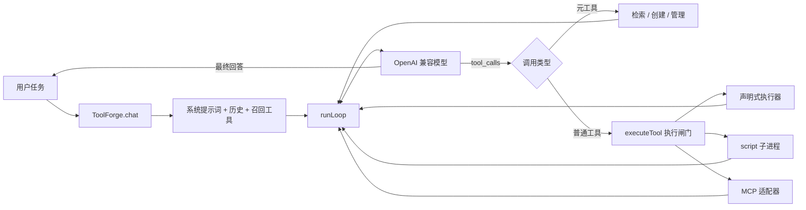

# ToolForge

> **Tool Is All You Need.**
>
> 创建你自己的 Agent：让模型负责决策，让工具把决策变成**可验证、可授权、可审计、可复用**的行动。

ToolForge 是一个以工具为中心的桌面 Agent 运行时。它不预置一张不断膨胀的能力清单，而是保留一个精简的 Agent 循环：需要能力时先检索已有工具；没有合适的，就通过 `create_tool` 定义、测试并创建一件新工具。

名字致敬 [《Attention Is All You Need》](https://arxiv.org/abs/1706.03762)。我们相信，Agent 的长期壁垒不只是更长的提示词或更多的工作流，而是一个能够持续积累、组合和治理能力的工具体系。


[快速开始](#快速开始) · [设计理念](#为什么是-tool-is-all-you-need) · [源码教程](./doc/README.md) · [开发指南](./AGENTS.md) · [GitHub](https://github.com/tzy168/toolforge)


> **项目状态：早期版本。** 核心创建、执行、审核、召回和桌面链路已经落地，接口与安全模型仍可能演进。它适合学习、实验和二次开发，不应被当作不可信代码的强隔离运行环境。

## 为什么是 Tool Is All You Need

传统 Agent 项目常把每种能力写成一个新分支：天气一个、搜索一个、文件处理一个。能力越多，主流程越复杂，模型可选的上下文也越臃肿。

ToolForge 把问题换成另一件事：**怎样让一项能力成为好工具？**

| 问题 | ToolForge 的回答 |
| --- | --- |
| 能力从哪里来？ | 本地创建、声明式组合，或接入 MCP 工具源 |
| 模型怎样找到它？ | 工具名、描述、标签与轻量召回，而非全量塞入上下文 |
| 新能力能直接用吗？ | 先校验规格、处理依赖、运行自带用例，再按能力定级 |
| 它会不会越权？ | 最小权限声明、执行闸门、路径与域名检查、子进程隔离 |
| 下次还要重写吗？ | 工具持久化、版本快照、导入导出，可组合成更大的能力 |
| 出问题怎么追？ | 统一 `ToolResult`、运行健康记录与 JSONL 审计日志 |

这不是“让模型随便执行代码”，而是给能力扩展加上一层工程约束：**契约先行、测试守门、权限显式、执行留痕。**

## 核心能力

- **一个精简循环**：流式解析模型输出，执行工具调用，把结果回灌，直到回答或到达边界。
- **五类可创建工具**：`http`、`transform`、`compose`、`script`、`shell`，声明式优先。
- **四件内核元工具**：检索、查看、创建和管理工具；创建能力本身也是一次工具调用。
- **创建流水线**：规格归一化并暂存 → 依赖闸门 → 自带用例与静态扫描 → 信任定级和状态流转。
- **统一执行入口**：可用性检查、JSON Schema 参数校验、执行器分发、健康记录和审计。
- **权限与工作区**：网络、文件、环境变量、外部命令分别授权；项目访问使用 `@workspace`。
- **上下文控制**：按任务召回工具、稳定排序、冻结本轮工具集、裁剪历史与超大工具结果。
- **可持续积累**：本地工具仓库、patch 版本升级、历史快照、工具包导入导出。
- **桌面与终端**：Electron 桌面端和 CLI 共用 `ToolForge` 核心；支持多服务商与工作区分组。
- **开放工具生态**：可选接入 MCP 服务器，复用已有工具而不是重复造轮子。

## 快速开始

### 环境要求

- Node.js **20+**，推荐 **22+**（Node 的权限模型在 22+ 更完整）
- pnpm（项目声明的版本见 `package.json` 的 `packageManager`）
- 一个支持 OpenAI 兼容 `chat.completions` 与工具调用的模型服务

```bash
git clone https://github.com/tzy168/toolforge.git
cd toolforge
pnpm install

# 构建脚本工具的离线依赖白名单；干净 clone 后建议执行一次
pnpm shared:deps

pnpm start   # 桌面端，自动先 build
# 或
pnpm cli     # 终端 REPL，自动先 build
```

国内网络安装 Electron 较慢时，可先设置镜像：

```bash
# macOS / Linux
ELECTRON_MIRROR=https://npmmirror.com/mirrors/electron/ pnpm install
```

```powershell
# Windows PowerShell
$env:ELECTRON_MIRROR="https://npmmirror.com/mirrors/electron/"
pnpm install
```

### 配置模型

桌面端打开 **设置 → 模型**：

- 内置 DeepSeek、Kimi 预设，填写 API Key，并选择或手动填写模型名。
- 自定义服务商需要名称、Base URL、模型名和 API Key。
- “获取模型”会请求服务商的 `/models` 接口；项目不猜测默认模型名。
- API Key 保存在主进程的 `~/.toolforge/settings.json`，不会通过状态接口返回渲染层；**当前文件不是加密密钥库，请妥善保护本机账户与目录权限**。

也可用环境变量启动，环境变量优先于对应配置：

| 变量 | 用途 |
| --- | --- |
| `OPENAI_API_KEY` | 模型 API Key |
| `OPENAI_BASE_URL` | OpenAI 兼容接口地址，通常以 `/v1` 结尾 |
| `OPENAI_MODEL` | 模型名 |
| `TOOLFORGE_HOME` | 数据目录，默认 `~/.toolforge` |
| `TOOLFORGE_MAX_STEPS` | 单轮最大步数，默认 120，硬上限 500 |

### 创建第一件工具

切到 **Create Tools**，输入：

> 创建一个名为 word_frequency 的纯计算工具，输入一段英文文本，返回按出现次数降序排列的词频，并带两条测试用例。

Agent 会生成工具规格并调用 `create_tool`。纯计算实现通常定为 `L0`，用例通过后自动进入工具池；涉及文件写入、环境变量或外部命令时，会进入人工审核流程。创建会话对未正式放行的工具有临时试用通道，跨会话常驻仍需满足状态与授权规则。

首次初始化时，空仓库会安装两件种子工具：`text_stats` 和 `github_repo_info`，分别展示纯计算与 HTTP 工具的基本形态。

## 一张图理解 ToolForge



`create_tool` 不是另一条硬编码的 Agent 工作流。它只是模型可以调用的一件元工具，因此同一个循环天然支持“发现缺口 → 创建能力 → 调用新能力 → 继续任务”。

## 工具：从规格到执行

一件工具不仅是一段代码，还是一份完整契约：

```ts
interface Tool {
  name: string;                 // 模型调用名，也是检索入口
  description: string;          // 什么时候该用、返回什么
  kind: 'http' | 'transform' | 'compose' | 'script' | 'shell' | 'mcp' | 'meta';
  input: JsonSchema;            // 参数边界
  impl: ToolImpl;               // 实现方式
  permissions: Permissions;     // 最小能力声明，默认全空
  examples: ToolExample[];      // 创建时的验收用例
  status: ToolStatus;           // active / pending / untested / rejected / disabled
  trust: TrustLevel;            // L0 / L1 / L2 / L3
  sessionId: string | null;     // 未正式放行时的会话归属
}
```

选择实现方式时，优先减少任意代码：

| 类型 | 适用场景 | 关键边界 |
| --- | --- | --- |
| `http` | API 取数、Webhook | 域名白名单、超时、模板渲染、响应路径提取 |
| `transform` | 纯计算与格式转换 | 受控 `node:vm` 上下文、同步超时 |
| `compose` | 串联已有工具 | 前序结果模板引用、统一递归调度、深度限制 |
| `script` | 需要分支、循环或依赖的复杂逻辑 | 子进程、受控 `ctx`、文件与网络检查 |
| `shell` | 确实必须调用外部程序 | 显式 `exec`、可执行文件白名单、拒绝 shell 元字符 |

详细的字段约束与完整示例见 [工具契约](./doc/03-tool-contract.md)。

## 信任与安全

信任等级描述**能力风险**，状态描述**生命周期**，两者不能混为一谈。

| 等级 | 典型能力 | 创建后的默认处理 |
| --- | --- | --- |
| `L0` | 无额外权限的纯计算 | 用例通过后自动放行 |
| `L1` | 只读网络/文件，或运行 `script` | 用例通过后自动放行 |
| `L2` | 写文件、写工作区或读取指定环境变量 | 转人工审核 |
| `L3` | 外部命令、高危扫描命中、白名单外依赖 | 转人工审核或直接阻断相应阶段 |

主要防线：

1. **规格与参数**：所有入库规格经过 `normalizeTool`，普通调用经过 Ajv 参数校验。
2. **最小权限**：域名、路径、环境变量和命令执行默认关闭，`*` 全网通配不被接受。
3. **执行隔离**：`script` 在独立子进程中运行，优先启用 Node `--permission`，并限制可见模块和受控 IO。
4. **人工授权**：高风险能力进入审核；写 `@workspace` 明确标为会修改用户项目。
5. **可追踪性**：调用摘要、错误、耗时、定级和依赖来源写入本地审计。

**安全边界必须说清楚：**

- 静态扫描是启发式筛子，不是恶意代码证明器；`node:vm` 也不等于强安全边界。
- 运行环境不支持权限开关时，`script` 会降级为无 OS 级文件权限隔离；实际探测状态见 **设置 → 工具 → 运行环境**。
- 自带用例本身会执行工具代码。白名单外依赖在联网安装开关关闭时不会先安装、先执行再请示。
- 会话内临时可用不等于已人工批准，也不等于工具绝对安全。
- MCP 服务器是独立配置的外部信任边界，不能把本地工具标签当作其真实能力的完整审计。

## 工作区、MCP 与工具包

### 每个任务自己的工作区

桌面端在输入框上方选择工作区：

- **项目目录**：工具可通过 `fsRead: ['@workspace']` 或 `fsWrite: ['@workspace']` 申请访问。
- **通用工作区**：适合不绑定项目目录的计算或查询任务。
- **未选择**：不提供项目路径，工具需要目录时会明确报错。

工作区随任务保存，并在每轮 `chat()` 调用时显式传递。只读工作区为 L1；写入工作区为 L2。工作区授权是额外通道，不是把整个磁盘开放给脚本。

### 接入 MCP

在 `~/.toolforge/mcp.json` 的 `servers` 中配置 stdio MCP 服务器。重启后，远端工具会被适配成统一的 `Tool` 形状并参与召回和调用。MCP SDK 是可选依赖；未安装或某台服务器连接失败，不影响核心 Agent 启动。

### 分享工具包

设置页支持导出和导入 `toolforge.pack/1` JSON 工具包。默认导入为待审核状态；同版本工具不会重复覆盖，高危静态扫描命中会被拒收。导入工具包不等于信任其代码，仍需检查实现、权限与依赖。

## 源码导读

[`doc/`](./doc/README.md) 是给 Agent 开发者准备的循序渐进教程，不只解释“有什么”，还解释“为什么这样拆”。

| 步骤 | 主题 | 你将理解 |
| --- | --- | --- |
| [01](./doc/01-architecture.md) | 整体架构 | 一次任务如何穿过整个系统 |
| [02](./doc/02-agent-loop.md) | Agent 循环 | 流式协议、消息回灌、停止条件 |
| [03](./doc/03-tool-contract.md) | 工具契约 | 类型、规格、模板与组合 |
| [04](./doc/04-create-tool.md) | 创建与审核 | 测试、定级、会话与版本 |
| [05](./doc/05-execution-security.md) | 执行与安全 | 执行闸门、权限、子进程协议 |
| [06](./doc/06-context-cache.md) | 上下文与缓存 | 工具召回、稳定前缀、事件协议 |
| [07](./doc/07-ui-and-mcp.md) | 桌面端与 MCP | IPC、流式状态、外部工具适配 |
| [08](./doc/08-extend-and-verify.md) | 扩展与验证 | 加新类型、测试策略、实践练习 |

如果你准备改代码，也请阅读 [`AGENTS.md`](./AGENTS.md)：它记录仓库级硬约束和已经踩过的坑。

## 开发与验证

```bash
pnpm typecheck        # 主进程 / CLI / 渲染层类型检查
pnpm test             # 构建并运行核心单元测试
pnpm selftest         # 造工具全链路 13 项自检
pnpm verify:switch    # 桌面任务切换、流式恢复与超时回归
pnpm verify:toolfilter# 工具等级筛选、搜索与状态保持回归
pnpm verify:deps      # 依赖闸门验证
pnpm verify:gate      # 执行闸门验证
pnpm verify:whitelist # 离线依赖白名单验收

pnpm pack:desktop     # Windows 绿色目录产物
pnpm verify:pack      # 拉起打包产物做真实验证
pnpm installer        # Windows 单文件安装包（当前未签名）
```

测试和自检请使用临时 `TOOLFORGE_HOME`，避免污染日常工具仓库。不同验证命令的环境要求与覆盖范围见 [扩展与验证](./doc/08-extend-and-verify.md)。

技术栈刻意保持轻量：TypeScript、Node 内建能力、OpenAI SDK、Ajv、Electron；界面为 HTML/CSS/JS，模型 Markdown 经 `marked` 渲染后再由 DOMPurify 清洗。

## 数据目录

CLI 与桌面端默认共享 `~/.toolforge/`：

```text
~/.toolforge/
├── tools/<id>/          # tool.json、脚本入口、.data/、.history/
├── packs/               # 导出的工具包
├── audit/               # 按日期切分的 JSONL 调用与审核日志
├── staging/             # 暂存及删除前备份
├── mcp.json             # MCP 服务器配置
└── settings.json        # 模型、工作区与依赖策略
```

## 值得共建的方向

以下是建设方向，不代表已经完成：

- 更强的代码审查：从正则筛查走向 AST 分析与更明确的安全策略。
- 更可靠的隔离：减少对运行时权限开关降级的依赖，补充跨平台安全测试。
- 更好的工具检索：评估可复现的本地向量召回，同时保留缓存友好性。
- 更系统的工具评测：回归用例、组合工具测试、失败恢复与供应链审计。
- 更完整的发布工程：开源许可证、贡献指南、CI、签名安装包与跨平台分发。

## 参与贡献

欢迎围绕工具协议、执行安全、召回评估、开发体验和文档提出 Issue 或 Pull Request。提交代码前请至少运行与改动相关的检查和测试；安全相关改动请清楚说明威胁模型，不要把启发式检查描述成形式化保证。

## License

**当前仓库尚未附带 `LICENSE` 文件，默认保留所有权利。** 这意味着源码公开可读，但尚不能等同于采用 OSI 许可证的开源项目；未经作者书面许可，不应再分发、商用或发布衍生版本。

若要将 ToolForge 作为主力开源项目维护，下一步需要由作者明确选择许可证（例如 MIT 或 Apache-2.0）、添加 `LICENSE`，并同步更新本节的许可说明。
